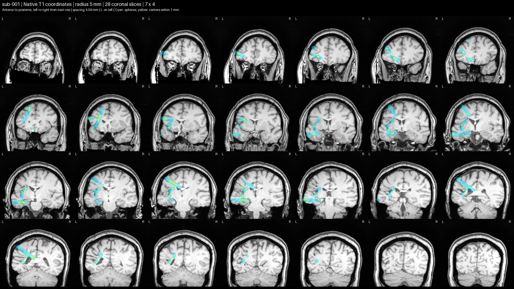
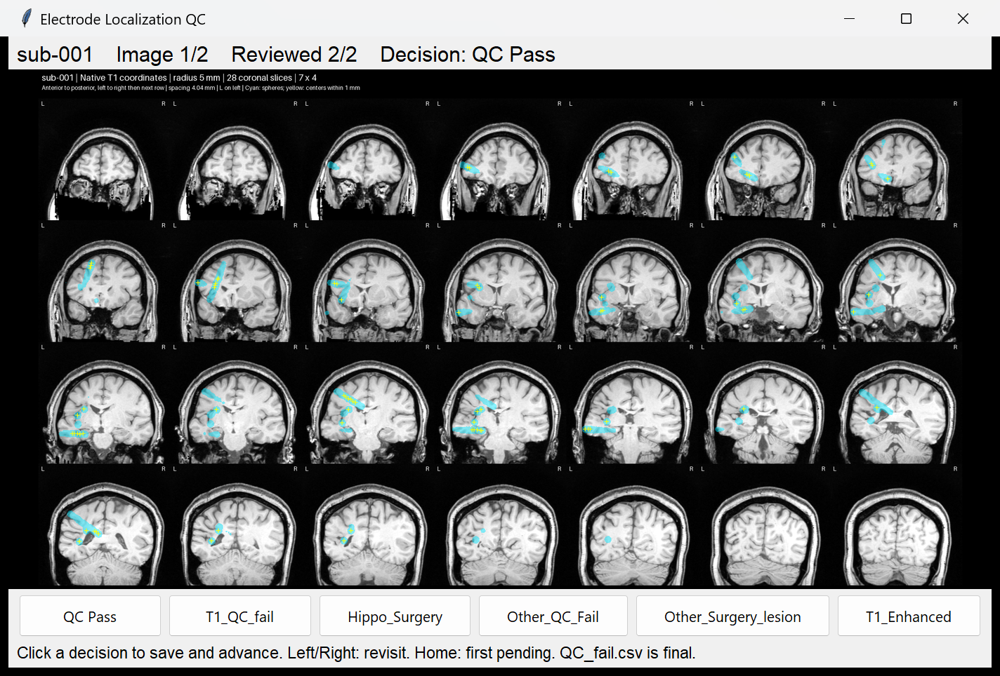
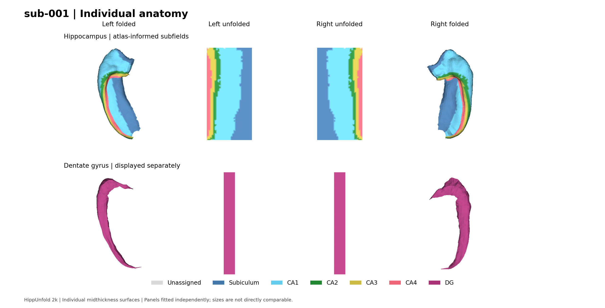
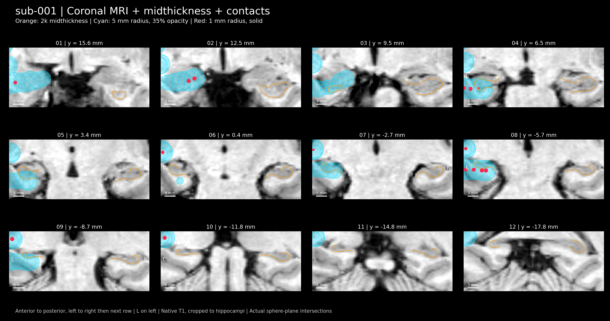
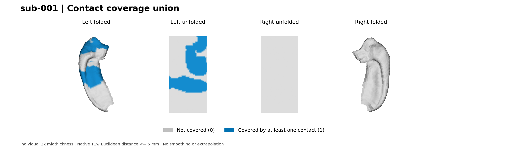

# Hippocampal Electrode Localization

This project provides a reproducible workflow for locating intracranial electrode contacts relative to each participant's hippocampal anatomy. Starting from a native T1-weighted MRI and contact coordinates in the same physical space, it identifies contacts near the hippocampal surface, describes their anatomical positions and subfield relationships, and summarizes individual and combined contact coverage. The outputs include contact and participant tables, surface maps, and MRI overlays for anatomical review.

The core localization approach is broadly consistent with the iEEG localization and surface-mapping methods in [DeKraker et al. (2025), *HippoMaps: multiscale cartography of human hippocampal organization*, Nature Methods](https://www.nature.com/articles/s41592-025-02783-3#Sec22): contacts are related to hippocampal surface vertices using their spatial proximity, with a 5 mm neighborhood. This implementation uses native-space Euclidean distances to the hippocampal midthickness surface and includes vertices at distances **less than or equal to 5 mm** by default; the paper describes a **less than 5 mm** criterion. The radius can be changed. This repository covers anatomical localization and coverage; the paper's electrophysiological analyses, geodesic extrapolation, and group averaging are outside its scope.

The workflow uses two complementary software packages:

| Software | Role in this project |
| --- | --- |
| [HippUnfold](https://github.com/khanlab/hippunfold) | Segments the hippocampus from T1 MRI and generates native and unfolded surfaces, subfield labels, anatomical coordinates, and regional volumes. |
| [HippoMaps](https://github.com/MICA-MNI/hippomaps) | Provides tools for working with folded and unfolded hippocampal surfaces. This project uses its geometry and plotting utilities together with BrainSpace to visualize individual anatomy and contact coverage. |

Around this localization method, the project adds explicit quality-control and visualization steps: automated coordinate and image-boundary checks, contact overlays before segmentation, a saved human review with exclusion decisions and priority flags, and checks that downstream processing uses the reviewed inputs. After segmentation, surface views and MRI overlays support inspection of subfields, hippocampal boundaries, individual contact distances, and combined coverage. These outputs make each participant's localization easier to inspect and trace through the workflow.

The required inputs are `data/native_T1/*.nii.gz` and `data/coordinates.csv`. Contact coordinates must already match the native T1 image; obtaining coordinates from implantation images and registering them to T1 space are upstream preparation steps.

This tutorial takes you from installing the software to viewing hippocampal electrode maps. Start with the two example participants included in the project.

Follow the section for your operating system. Copy one command at a time, press Enter, and wait for it to finish before continuing. Commands go in PowerShell on Windows and Terminal on macOS or Linux.

## 1. Install the container software

| Your computer | Install |
| --- | --- |
| Windows | Docker Desktop |
| macOS | Docker Desktop |
| Linux | Apptainer |

### Windows

1. Open the [Docker Desktop for Windows installation page](https://docs.docker.com/desktop/setup/install/windows-install/) and download the installer for your computer.
2. Run the installer. Select the WSL 2 backend if offered. Restart Windows if requested.
3. If the installer asks you to install WSL, open PowerShell as Administrator, run `wsl --install`, and restart the computer. Then finish installing Docker Desktop.
4. Open Docker Desktop and wait until the engine is running. Keep it open while using this project.
5. Open a normal PowerShell window and run:

```powershell
docker info --format '{{.OSType}}'
```

The answer should be `linux`. If it says `windows`, use the Docker Desktop menu to switch to Linux containers.

### macOS

1. Open **Apple menu > About This Mac** and check whether the computer uses Apple Silicon or Intel.
2. Download the matching installer from [Docker Desktop for Mac](https://docs.docker.com/desktop/setup/install/mac-install/).
3. Open the downloaded file, drag Docker to Applications, and open Docker. Follow the setup prompts.
4. Wait until the engine is running, then open Terminal and run:

```bash
docker info --format '{{.OSType}}'
```

The answer should be `linux`. Keep Docker Desktop open. The project requests the same amd64 image on both Intel and Apple Silicon Macs.

### Linux

Use an x86_64 Linux computer. Run `uname -m` to check; the expected answer is `x86_64`.

First check whether Apptainer is already available:

```bash
apptainer --version
```

If a version appears, continue to section 2.

**On an HPC cluster:** Apptainer may already be installed but needs to be loaded into your terminal session. Try:

```bash
module load apptainer
apptainer --version
```

If the module is not found, run `module avail apptainer` to look for the available name or version, or ask the cluster administrator for the correct loading command. Do not use the `sudo` installation commands below on a shared cluster.

Load the module again whenever you open a new terminal or start a compute session. Run Step0 and Step3 in a session where `apptainer --version` works. If you submit Step3 as a batch job, include `module load apptainer` in the job script before the Python command. Use the module name required by your cluster.

On an Ubuntu computer where you have administrator access, install Apptainer with:

```bash
sudo apt update
sudo apt install -y software-properties-common
sudo add-apt-repository -y ppa:apptainer/ppa
sudo apt update
sudo apt install -y apptainer
apptainer --version
```

On Rocky Linux or AlmaLinux, use:

```bash
sudo dnf install -y epel-release
sudo dnf install -y apptainer
apptainer --version
```

For other distributions or installation without administrator access, use the [official Apptainer installation guide](https://apptainer.org/docs/admin/main/installation.html). Linux processing uses Apptainer and does not require Docker.

**What this produces:** An installed container application, or an Apptainer module available in your HPC session. It will run HippUnfold in Step3. No participant results are created here.

## 2. Install uv

uv installs the required Python version and Python packages for you. You do not need to install Python or Conda separately.

First run:

```text
uv --version
```

If a version appears, go to section 3. Otherwise, choose the installation command below.

**Windows, in PowerShell:**

```powershell
powershell -ExecutionPolicy ByPass -c "irm https://astral.sh/uv/install.ps1 | iex"
```

**macOS or Linux, in Terminal:**

```bash
curl -LsSf https://astral.sh/uv/install.sh | sh
```

If Linux reports that `curl` is unavailable, use:

```bash
wget -qO- https://astral.sh/uv/install.sh | sh
```

These installers normally install uv for your own user account, without administrator access. Close the terminal, open a new one, and run `uv --version` again. Continue when a version number appears. If your organization blocks the installer, ask its administrator to install uv using the [official installation instructions](https://docs.astral.sh/uv/getting-started/installation/).

**HPC without a uv module:** If `uv --version` reports `command not found` and `module avail` does not list uv, install it under your own account. You do not need `sudo`, a Python module, or Anaconda. If you already ran the Linux installer above, skip the first command:

```bash
curl -LsSf https://astral.sh/uv/install.sh | sh
export PATH="$HOME/.local/bin:$PATH"
uv --version
```

If `curl` is unavailable, use the `wget` installation command above instead. Continue when `uv --version` prints a version number. If the download times out or access is denied, ask the cluster administrator about permitted download access.

Load the available Apptainer module. For a cluster listing `apptainer/1.1.9`, run:

```bash
module load apptainer/1.1.9
apptainer --version
```

Use your cluster's module name if it differs. In a new login session or batch job, make uv available and load Apptainer before running the project commands:

```bash
export PATH="$HOME/.local/bin:$PATH"
module load apptainer/1.1.9
```

These commands install uv and load Apptainer; they do not create the project `.venv`. Continue to section 3 to create the environment with Step0.

**What this produces:** The `uv` command is available on your computer. It manages Python and the project packages. The project's `.venv` is created later by Step0.

## 3. Set up the project with Step0

In your terminal, use `cd` to navigate to the repository folder. Run all commands below from that folder.

On an HPC cluster, run `module load apptainer` again if you reopened the terminal after installing uv. Check that `apptainer --version` works in this terminal.

Run this same command on Windows, macOS, or Linux:

```text
uv run --no-project --isolated --managed-python --python 3.11.16 python Step0_SetupRuntime.py
```

The first run downloads Python, installs the project packages, and prepares the HippUnfold image. It may take some time. Linux downloads a local Apptainer SIF image; Windows and macOS prepare a Docker image. Do not close the terminal while downloads are running.

Continue when the last message says:

```text
Runtime ready. Continue with Step1_LocalizationQC.py.
```

**Outputs and their use:**

| Output | What it is used for |
| --- | --- |
| `.venv/` | The project's Python environment and installed packages, used by Steps 1 through 5. |
| `tmp/containers/hippunfold-ba8059f0e797d3db.sif` on Linux | The HippUnfold container file that Apptainer runs in Step3. Keep it for later runs. |
| HippUnfold image in Docker's local image storage on Windows/macOS | The container used by Step3. Docker manages its storage; it is not a file in the project folder. |

The supplied `pyproject.toml`, `uv.lock`, and `.python-version` define the environment. They are setup inputs, not participant results.

## 4. Check the example inputs

The supplied files are arranged like this:

```text
data/
    coordinates.csv
    native_T1/
        sub-001_T1w.nii.gz
        sub-002_T1w.nii.gz
```

For your first run, use these files without editing them. The coordinate table contains `subject`, `lead`, `contact`, `x_mm`, `y_mm`, and `z_mm`. Each participant ID matches its T1 filename. There is no separate participant table.

When you later use your own data, the coordinates must already be in the matching native T1 physical space, in millimeters. Voxel indices and standard-template coordinates are not interchangeable with these coordinates. Coordinates use native T1 RAS+ physical axes: x increases to the right, y anteriorly, and z superiorly.

**What this produces:** No new files. `coordinates.csv` supplies the electrode locations, and each `native_T1` image supplies the matching anatomy for localization and segmentation.

## 5. Generate localization images with Step1

If all current T1 images and contact coordinates have already undergone localization QC elsewhere, you may use the external-QC route described in section 6 and proceed directly to Step3. Otherwise, complete Steps 1 and 2 below.

```text
uv run --locked python Step1_LocalizationQC.py
```

This creates images showing the electrode locations on each T1 scan. Wait until both participants have been processed. The images are saved in `results/localization_qc/coronal_qc`.

**Outputs and their use:** All files below are under `results/localization_qc/`. The examples use `sub-001`; the same files are produced for `sub-002` when its inputs are valid.

| File | What it is used for |
| --- | --- |
| `coronal_qc/sub-001.png` | T1 slice images with electrode overlays. Step2 displays these for human review. |
| `contact_spheres_r5mm/sub-001.nii.gz` | A three-dimensional mask of the 5 mm neighborhoods around contacts, for inspection in an MRI viewer. |
| `T1_contact_spheres_r5mm/sub-001.nii.gz` | A display copy of the T1 with contact neighborhoods marked. The original T1 is preserved. |
| `contact_qc.csv` | One row per contact, reporting coordinate validity, whether its center is inside the image, and whether its neighborhood extends beyond the image. |
| `subject_qc.csv` | One row per participant, summarizing localization checks and image generation. Step2 uses it for review; later steps use it to detect changed inputs. |

The `r5mm` folder names reflect the default display radius. These files support localization review; Step4 calculates hippocampal surface coverage separately.

**Example: localization review for `sub-001`.** Cyan regions show the 5 mm contact neighborhoods on native T1 coronal slices. Yellow markers indicate contact centers within 1 mm of each slice. Use these views to inspect coordinate alignment before segmentation; the image does not replace the human review in Step2.



## 6. Review the images with Step2

This step needs a graphical desktop. If you use a remote Linux server, open its remote desktop and continue in a terminal there. A plain SSH terminal without graphics cannot show the review window.

```text
uv run --locked python Step2_ReviewLocalizationQC.py
```

For each participant, inspect the T1 and electrode overlay, then select the appropriate button:

| Button | Meaning |
| --- | --- |
| QC Pass | Accept the localization |
| T1_QC_fail | Exclude because the T1 is unsuitable |
| Hippo_Surgery | Exclude because of hippocampal surgery |
| Other_QC_Fail | Exclude for another localization QC problem |
| Other_Surgery_lesion | Retain and flag for careful segmentation review |
| T1_Enhanced | Retain and flag a contrast-enhanced T1 for careful segmentation review |

Ask the researcher responsible for localization if you are unsure which decision applies. Each decision is saved immediately. You can close and reopen the window to continue later. Use the arrow keys to revisit images.

**Example: Step2 review window.** The screenshot shows `sub-001` reopened after the saved example review was completed. The header displays the participant, review progress, and saved decision; the six buttons below the image record the reviewer's choice. A new review starts with unreviewed participants and requires your own decisions.



Wait for **Review complete**, then close the window. Continue only after the final `QC_fail.csv` has been written. Do not manually fill in pass decisions to skip this review.

**Outputs and their use:** All files below are under `results/localization_qc/`.

| File | What it is used for |
| --- | --- |
| `manual_qc.csv` | Saves each participant's review decision and time. Reopening Step2 restores these decisions. |
| `QC_fail_in_progress.csv` | The provisional exclusion list while review is in progress. It does not authorize starting Step3. |
| `QC_fail.csv` | The final exclusion list, written after review is complete. Steps 3 through 5 use it together with the review records to select retained participants. A header-only table means no participants were excluded. |
| `segmentation_priority_qc.csv` | Flags retained participants with other surgery/lesions or contrast-enhanced T1 images for closer segmentation review. These flags do not exclude them. |

### Alternative: reuse completed external QC

If every participant's current T1 image and matching contact coordinates have already been reviewed elsewhere, you can skip Step2. Step1 is optional in this route if you want additional localization images. Copy an existing exclusion table, or write one from the completed review, to:

```text
results/localization_qc/QC_fail.csv
```

Create `results/localization_qc` if it does not exist. Save a plain UTF-8 CSV with exactly these columns. Include only excluded participants, with one row per participant and IDs matching `data/coordinates.csv`. For example, if `sub-002` was excluded:

```csv
subject,reason
sub-002,T1_QC_fail
```

If every participant passed external QC, the file must contain the header only:

```csv
subject,reason
```

Participants absent from this file are treated as retained. Every listed exclusion needs a reason. Adapt an older table to the current participant IDs and include only participants in the current coordinate file. A reusable table must describe the current T1 images and coordinates; a CSV alone cannot verify that an earlier review still applies.

Use the following commands in sequence instead of the ordinary Step3, Step4, and Step5 commands below:

```text
uv run --locked python Step3_RunHippUnfold.py --external-qc
uv run --locked python Step4_ComputeContactCoverage.py --external-qc
uv run --locked python Step5_VisualizeHippoMaps.py --external-qc
```

`--external-qc` explicitly confirms that external review is complete. It does not require or create `manual_qc.csv` or `subject_qc.csv`. Steps still check the exclusion table, retained participants' T1 availability, and complete finite coordinates. Step3 records the external-QC source and input fingerprints in `segmentation_config.json`. Without this option, the original Step2 review checks remain required.

## 7. Segment the hippocampi with Step3

On an HPC cluster, first enter a compute session with at least 12 CPU cores using your cluster's instructions. In that session, open the project folder and run `module load apptainer` before the following command. Ask the administrator for the compute-session command if you do not know it.

```text
uv run --locked python Step3_RunHippUnfold.py
```

The script automatically uses Apptainer on Linux and Docker on Windows or macOS. It processes retained participants one at a time, requesting 12 CPU cores. On a shared server, use a compute session allocated at least 12 cores. On Docker Desktop, make at least 12 CPUs available to Docker before this step.

The first segmentation may also download model files. Leave the terminal open and wait for the command prompt to return. Results are saved in `results/hippunfold`. Step3 supplies `--force-output` because it writes `segmentation_config.json` into this dedicated directory before starting HippUnfold. Keep this directory reserved for this project's HippUnfold outputs.

**Outputs and their use:** The main participant outputs are under `results/hippunfold/sub-001/`, with a corresponding folder for each retained participant. Keep the complete output folders for Steps 4 and 5.

| File or folder | What it is used for |
| --- | --- |
| `anat/` | MRI images, segmented hippocampal regions, and regional volume tables ending in `_volumes.tsv`. Step4 reads the volumes; Step5 uses the images and segmentation for MRI overlays. |
| `surf/*.surf.gii` | Hippocampal and dentate surface meshes. Step4 measures contact distances on the native hippocampal surface; Step5 draws the anatomy. |
| `metric/*.shape.gii` and `metric/*.label.gii` | Surface measurements, anatomical coordinates, and subfield labels. Steps 4 and 5 use these to describe and display contact locations. |
| `results/hippunfold/segmentation_config.json` | Records the selected participants, container, settings, and input fingerprints for tracing how segmentation was run. Its presence alone does not mean segmentation finished. |
| `tmp/hippunfold_cache/` | Downloaded HippUnfold resources reused across runs. This is a software cache, not a participant result. |

## 8. Calculate contact coverage with Step4

```text
uv run --locked python Step4_ComputeContactCoverage.py
```

The default radius is **5 mm**. The main result is `results/localization_hippo.xlsx`, containing contact details in `Contacts` and participant summaries in `subjects`.

For a different radius, add it to this command, for example:

```text
uv run --locked python Step4_ComputeContactCoverage.py --radius-mm 3
```

This replaces the current coverage table. You do not need to rerun segmentation when changing the coverage radius.

**Outputs and their use:**

| File or worksheet | What it is used for |
| --- | --- |
| `results/localization_hippo.xlsx`, sheet `Contacts` | One row per contact and hemisphere with surface coverage. Includes native coordinates, distance, radius, covered vertex count, anatomical position, and subfield composition. Open this sheet to inspect individual contacts. |
| The same workbook, sheet `subjects` | One row per participant with left/right regional volumes, contact counts, and combined surface coverage. Open this sheet for participant summaries. |
| `results/contact_overlap/sub-001/*_desc-contact*_distance.shape.gii` | Per-contact distances in millimeters inside the selected neighborhood. Values outside coverage are zero, so these files must be interpreted with their coverage masks. |
| `results/contact_overlap/sub-001/*_desc-contact*_coverage.shape.gii` | Per-contact binary surface masks: 1 means covered and 0 means uncovered. Step5 uses them to display contact neighborhoods. |
| `results/contact_overlap/sub-001/*_desc-contactUnion_coverage.shape.gii` | One combined coverage mask per hemisphere. Overlapping contact neighborhoods count once. Step5 uses these for the participant coverage maps. |

Here `*` represents the remaining filename text. The per-contact rows above refer to individual contacts; `contactUnion` files are combined masks. The same folder structure applies to every retained participant. GIFTI (`.gii`) files contain surface data; Step5 turns them into viewable PNG images.

## 9. Draw the maps with Step5

```text
uv run --locked python Step5_VisualizeHippoMaps.py
```

Step5 reads the radius saved by Step4. Open `results/visual_qc/sub-001` and `results/visual_qc/sub-002` to view the surface maps, MRI overlays, and contact coverage figures for the retained participants.

Coverage describes anatomical proximity to the hippocampal surface. It does not measure how much tissue contributes to an electrical recording.

**Outputs and their use:** The following examples are under `results/visual_qc/sub-001/`. Each retained participant has its own folder. Open PNG files with a normal image viewer.

| File | What to inspect |
| --- | --- |
| `sub-001_anatomy.png` | Individual hippocampal subfields and the separately displayed dentate gyrus. |
| `sub-001_morphology.png` | Surface thickness, gyrification, and curvature. |
| `sub-001_coordinates.png` | Anatomical positions along the anterior-posterior and proximal-distal directions. |
| `sub-001_sagittal_midthickness_contacts.png` and `sub-001_coronal_midthickness_contacts.png` | Contact neighborhoods and the hippocampal middle surface overlaid on MRI slices. Use these to check their anatomical alignment. |
| `sub-001_sagittal_subfields.png` and `sub-001_coronal_subfields.png` | Subfield segmentation overlaid on MRI, for checking regional boundaries. |
| `sub-001_sagittal_ribbon_surfaces.png` and `sub-001_coronal_ribbon_surfaces.png` | Inner, middle, and outer hippocampal surface boundaries on MRI, for checking the segmented ribbon. |
| `sub-001_contactUnion_coverage.png` | Combined surface coverage from all retained contacts, with overlapping neighborhoods counted once. |
| `contact_distance/sub-001_contact-*_distance.png` | A separate distance map for each contact with hippocampal surface coverage. |

Temporary rendering panels are stored in `tmp/hippomaps_rendering/`. Use the assembled images in `results/visual_qc/` for review.

### Example maps from sub-001

These examples use the existing outputs for the first example participant and a 5 mm coverage radius.

**Individual anatomy.** Folded and unfolded views show the hippocampal subfield labels, with the dentate gyrus displayed separately below. Panels are fitted independently, so their displayed sizes should not be compared.



**Contacts on MRI.** Orange contours mark the hippocampal midthickness surface. Cyan regions show intersections of the 5 mm contact neighborhoods with each coronal slice; red regions show the smaller 1 mm spheres around contact centers. Inspect the alignment of the surface and contact neighborhoods with the underlying anatomy.



**Combined contact coverage.** Blue marks surface vertices within 5 mm of at least one contact. Overlapping neighborhoods count once. Gray marks vertices outside this coverage, not electrically inactive tissue. This example shows coverage on the left hippocampus.




